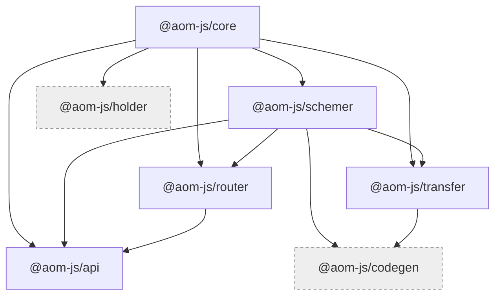
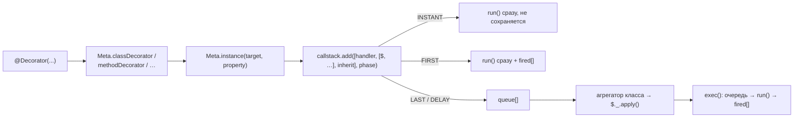
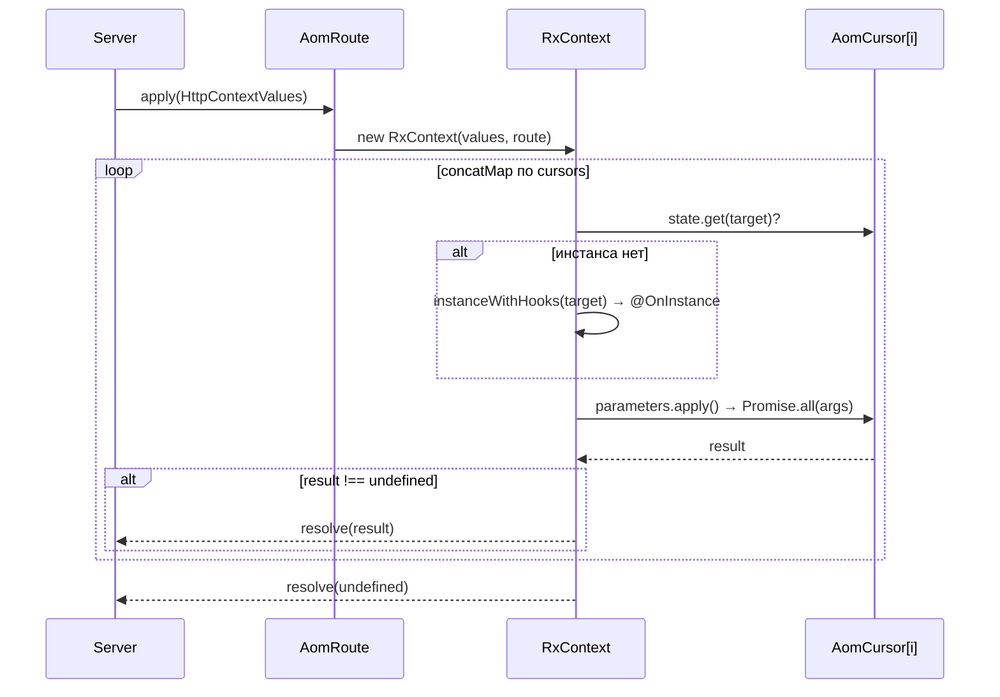

# Архитектура ядра aom.js

Обзор монорепо `@aom-js/*`: состав пакетов, их зависимости, общая модель метаданных, путь от класса-контроллера до HTTP-сервера и документа OpenAPI, сборка и потребление ядра приложением. Состояние на 2026-09-02.
Документ — точка входа: механика каждого пакета описана в его `readme.md`, здесь только карта и сквозные вещи. Ядро и приложение лежат соседними каталогами `main/` и `test/` в `/Users/scarych/devel/aom.js/`; в текстах ядра пути даются от корня ядра, ссылки на приложение — с префиксом `test/`.
Читать после: `packages/core/readme.md`, `packages/router/readme.md`, `test/docs/architecture.md`. Термины — `test/docs/README.md#словарь`.

## Состав монорепо и граф зависимостей

Монорепо — `bun`-workspaces с единственным шаблоном `packages/*` (`package.json:15-18`). Семь пакетов, все публикуются под скоупом `@aom-js`.

| Пакет | Версия | Назначение | Зависит от | Кем используется | Используется приложением |
|---|---|---|---|---|---|
| `@aom-js/core` | 0.0.4 | Реестр мета-инстансов и фабрики legacy-декораторов с отложенным исполнением | — | schemer, router, transfer, holder, api | да (`test/src/modules/tickets/api/routes/tickets/init/aom.ts`, 1 файл) |
| `@aom-js/schemer` | 0.0.11 | Класс = DTO + JSON Schema + валидация; сборщик компонентов | core | router, transfer, api, codegen | да (80 файлов) |
| `@aom-js/router` | 0.0.1 | Карта HTTP/WS-маршрутов из классов-контроллеров и её исполнение | core, schemer | api | да (208 файлов) |
| `@aom-js/api` | 0.0.1 | HTTP-сервер на `node:http`, билдеры, базовые контроллеры, ответы, локализация | core, schemer, router | — | да (121 файл) |
| `@aom-js/transfer` | 0.0.7 | Изоляторы/исполнители и RPC поверх абстрактной шины | core, schemer | codegen | да (11 файлов) |
| `@aom-js/holder` | 0.0.1 | Отложенное применение сторонних декораторов на конечном потомке | core | — | нет (симлинк есть, импортов нет) |
| `@aom-js/codegen` | 0.0.1 | Генерация исходников aom-классов из дескриптора изолятора | schemer, transfer | — | нет (симлинка нет) |

Версии — из `packages/<pkg>/package.version.json`, зависимости — из `packages/<pkg>/package.src.json` (`dependencies`, ссылки внутри монорепо — `workspace:*`). Счётчики файлов приложения получены `grep -rl "@aom-js/<pkg>" test/src`.



Пунктиром — пакеты, которые приложение не потребляет.

Внешние зависимости:

| Пакет | Внешние runtime-зависимости |
|---|---|
| `core` | нет (`dependencies: {}`) |
| `schemer` | `class-transformer`; `class-validator`; `class-validator-jsonschema`; `reflect-metadata` |
| `router` | `openapi3-ts`; `reflect-metadata`; `rxjs` |
| `api` | `ws`; `dayjs`; `es-toolkit`; `reflect-metadata` |
| `transfer` | `rxjs`; `reflect-metadata` |
| `holder` | `reflect-metadata` |
| `codegen` | нет внешних (только `@aom-js/schemer`, `@aom-js/transfer`) |

`core` действительно свободен от внешних зависимостей, но общий набор шире, чем предполагали черновики (см. «Расхождения с историческими заметками»).

Граф раскладывается на три слоя. Внизу — `core`: механизм метаданных, ничего не знающий ни про HTTP, ни про схемы. Средний слой — три независимые друг от друга специализации этого механизма: `schemer` (описание данных), `router` (карта и исполнение маршрутов, поверх `schemer` ради компонентов OpenAPI) и `transfer` (межпроцессные вызовы). Наверху — потребители: `api` собирает из `router` работающий сервис, `codegen` из `transfer`+`schemer` — исходники клиента. `holder` стоит сбоку: он расширяет `core` и ни от кого больше не зависит.

## Модель метаданных AomCore

Под всеми пакетами лежит один механизм. Мета-класс (`AomCore` и наследники) — это реестр: каждый наследник получает собственную `WeakMap` инстансов и собственные фабрики декораторов. Прикладные поля объявляются прямо в наследнике, служебная часть живёт в узле.

- **Мета-инстанс** (`$`) — `Meta.instance(target, property?)`: экземпляр мета-класса, привязанный к классу или к его свойству/методу (`packages/core/src/defines/core.ts:463-506`). Ключ реестра для метода — сам `descriptor.value`, для поля без дескриптора — синтетический инстанс из карт `properties`/`statics` (`core.ts:397-449`).
- **Узел** (`$._`, класс `AomNode`) — `target`, `property`, `root` (узел класса), карты `properties`/`statics`, список `origins` и `callstack` (`core.ts:223-301`). Не экспортируется.
- **Фаза** (`ExecutionPhase`) — `INSTANT`, `FIRST`, `LAST`, `DELAY` (`packages/core/src/defines/types.ts:14-20`). `FIRST` выполняется в момент декорирования и запоминается в `fired`; `LAST` и `DELAY` копятся в очереди до `apply()`; `DELAY` дополнительно уходит в `setTimeout`; `INSTANT` выполняется сразу и **нигде не сохраняется** (`core.ts:98-112`).



Фабрики декораторов — пять штук: `classDecorator`, `combinedDecorator`, `methodDecorator`, `propertyDecorator`, `parameterDecorator` (`core.ts:521-614`). Все устроены одинаково — получить инстанс и положить ленивый вызов в очередь фазы:

`packages/core/src/defines/core.ts:521-534`

```ts
static classDecorator<T extends AomCore>(
  this: AomClass<T>,
  handler: AomHandler<T>,
  storeFlag: ExecutionPhase = ExecutionPhase.FIRST,
  inherit?: InheritPlacement,
): ClassDecorator {
  const self = this; // t теперь типа AOMClass<T>
  return function (target: ClassType) {
    // Получаем AOM-инстанс для этого конструктора
    const targetInstance = self.instance(target);
    return targetInstance._.callstack.add([handler, [targetInstance], inherit], storeFlag);
    // Классные декораторы могут возвращать конструктор, но здесь мы только для сайд-эффекта
  };
}
```

**Агрегатор** — класс-декоратор в фазе `INSTANT`, который «закрывает» класс: наследует callstack родителей и запускает накопленные отложенные вызовы. У router это `@Controller()`:

`packages/router/src/decorators/controllers/index.ts:4-26`

```ts
export function Controller() {
  return AomApi.classDecorator(($) => {
    $.element.isController = true;
    // ...
    const inheritDecorators = (parent: ClassType) => {
      const $parent = $._.inherit(parent);
      // ...
    };
    inheritDecorators(Object.getPrototypeOf($._.target));
    $._.apply(); // вызовем собственные отложенные декораторы
  }, ExecutionPhase.INSTANT);
  // этот декоратор не сохраняем, чтобы не вызывать рекурсии при переносе
}
```

Аналоги: `@ComponentSchema` у schemer (`packages/schemer/src/defines/decorators.ts:14-45`), `@Isolator` у transfer, `@Apply`/`@Delay` у holder. Отложенная сторона — декораторы `LAST`, которые на момент своего вызова ещё не знают итогового класса: типичный пример — фабрики `PropertySchema.*`, навешивающие библиотечные декораторы `class-validator` только при `apply()` (`packages/schemer/src/defines/properties.ts:30-64`).

`packages/schemer/src/defines/properties.ts:30-64` (сокращённо)

```ts
const _String = (params: StringDescriptionsProperties): PropertyDecorator => {
  //
  return AomSchemas.propertyDecorator(($) => {
    checkExistsSchemaParams($);
    $.schemaName = SchemaTypes.STRING;
    $.schemaParams = params;

    const { originInstance, property } = $._;

    const decorators = [
      IsString({ ... }),
      params.isOptional ? IsOptional() : undefined,
      // ...
      ...(params.decorators || []), // добавим дополнительные декораторы
    ];

    // применим соответствующие декораторы
    decorateProperty(decorators, originInstance, property);
  }, ExecutionPhase.LAST);
};
```

Сырые `schemaName`/`schemaParams` остаются в мета-инстансе свойства — на них держатся mapped-types (см. «Роль schemer»).

**Наследование** — `$._.inherit(parent)` (`core.ts:303-363`): callstack родителя переносится на потомка с подменой первого аргумента (`transferTo`, `core.ts:135-177`), а декорированные статики и прототипные методы копируются на потомка **каррированной обёрткой**, чтобы у потомка появился собственный ключ реестра и собственный мета-инстанс (`core.ts:309-327`). Размещение переноса задаёт `InheritPlacement`: `APPEND` (по умолчанию), `PREPEND` (блоком в начало очереди, осмыслен только для отложенных фаз) и `SKIP` (`core.ts:160-175`).

Незакоммиченное дополнение `AomCore.resolveFor($, context)` доразрешает ссылку на статику родителя в мета-инстанс каррированной копии потомка (`core.ts:508-518`); подробнее — раздел «Состояние рабочего дерева».

> ⚠️ Дефект: вызовы фазы `INSTANT` не попадают в `fired` и потому не переносятся на потомка при `inherit()`.
> Evidence: `packages/core/src/defines/core.ts:109-111` (ветка `INSTANT` возвращает `run(value)` без `place(this.fired, …)`), тест `packages/holder/test/holder.test.ts:42-58` (`it.fails`).
> Последствия: `@Delay` из holder на предке не доезжает до потомка — корень `KI-HOLDER-01`.
> См. `KI-CORE-04` в `test/docs/known-issues.md`.

Механика реестра, фаз, каррирования и `resolveFor` целиком — `packages/core/readme.md` §«Ключевые механизмы».

Мета-классы по пакетам:

| Мета-класс | Пакет | Файл | Что хранит |
|---|---|---|---|
| `AomApi` | router | `packages/router/src/common/classes.ts:155-198` | `element` (роль метода, бриджи, миддлвари, маркеры, хуки), `openApi`, `delayStack` |
| `AomSchemas` | schemer | `packages/schemer/src/defines/module.ts:13-23` | `isComponentSchema`, `schemaName`/`schemaParams`, `connections`, `properties` |
| `AomIsolator` | transfer | `packages/transfer/src/defines/main.ts:19-60` | описание изолятора, топики, дескриптор дистрибуции |
| `AomHolder` | holder | `packages/holder/src/init.ts:3-5` | `queue: CombinedDecorator[]` |
| `AomAccessCore` | api | `packages/api/src/controllers/access/types.ts:6-12` | точки и типы доступа маршрута |
| `TicketsTypeRelay` | приложение | `test/src/modules/tickets/api/routes/tickets/init/aom.ts:19-21` | `required_type: ITicketTypeMetaData[]` |

`TicketsTypeRelay` — единственное место, где приложение импортирует `@aom-js/core` напрямую: прикладной мета-класс объявляется тем же способом, что и мета-классы ядра.

## Как router строит и исполняет маршруты

`new Router(root, docs)` рекурсивно обходит бриджи от корневого класса, а собранные маршруты регистрирует в документе OpenAPI (`packages/router/src/classes/router.ts:13-18`). На каждом уровне классовые `@Before` превращаются в курсоры и проталкиваются в дочерние бриджи, классовые `@After` — не проталкиваются и добавляются только к эндпоинтам текущего уровня (`router.ts:20-42`).

Для каждого эндпоинта создаётся `AomRoute`, который раскладывает курсоры в плоский список: `plain()` для каждого курсора сначала рекурсивно раскладывает его `pre_middlewares`, потом кладёт сам курсор, потом `post_middlewares`, потом `@Next` (`packages/router/src/common/classes.ts:295-321`). Сам эндпоинт добавляется последним элементом входного списка (`classes.ts:276-282`), после чего по всем курсорам прогоняются `@Marker`-обработчики в контексте объявившего их класса (`classes.ts:285-292`).

При создании курсора происходят две вещи: перепривязка `$` к классу-потомку через `AomApi.resolveFor` и однократная реализация отложенного стека `delayStack` (`ThisRef`/`RouteRef`/`FwdRef`) с последующим `$._.apply()` (`classes.ts:216-249`). Отложенные ссылки нужны там, где декоратор объявлен на базовом классе, а значение известно только у потомка или у конечного маршрута — на этом построены билдеры `@aom-js/api`.

Механика ссылок минимальна: `FwdRef(fn)`, `ThisRef(fn?)` и `RouteRef(fn?)` заворачивают функцию в контейнер (`packages/router/src/specials/references.ts:9-19`), у контейнера единственный метод `exec(constructor)`, применяющий функцию к переданному классу; у `FwdContainer` аргументов нет вовсе (`packages/router/src/common/references.ts:4-32`). Декоратор `DelayRefStack(container)` просто складывает контейнер в `$.delayStack` метода (`packages/router/src/decorators/openapi/index.ts:72-78`). Разворачивает стек курсор: `FwdContainer` вызывается без контекста, `ThisRefContainer` получает класс курсора, `RouteRefContainer` — класс эндпоинта, и результат каждого применяется через `Reflect.decorate` (`packages/router/src/common/classes.ts:236-245`).

Исполнение: `route.apply(context)` создаёт `RxContext` (значения запроса + `state: ClassInstanceMap`) и через `rxjs` `concatMap` последовательно проходит курсоры (`classes.ts:324-326,344-392`). Перед вызовом каждого метода гарантируется инстанс его класса в `state` (`Reflect.construct` + параллельный запуск `@OnInstance`-хуков, `classes.ts:175-197`), затем `Promise.all` собирает аргументы из обработчиков параметров, затем вызывается статический метод. Первый результат `!== undefined` завершает цепочку и становится ответом; `Error` — возвращённый или брошенный — уходит в `reject`.



> ⚠️ Дефект: два `@This(X)` в одном методе создают два инстанса `X`.
> Evidence: `packages/router/src/decorators/arguments/index.ts:261-264` (check-then-create по `context.state` без дедупликации) и `packages/router/src/common/classes.ts:359-361` (аргументы решаются конкурентно через `Promise.all`); тест `packages/router/test/router-exec.test.ts:211-228` (`it.fails`).
> Последствия: двойной запуск `@OnInstance`, разъехавшееся состояние между аргументами одного метода.
> Как обходить: запрашивать `@This(X)` один раз, второе значение брать из первого. См. `KI-ROUTER-01` в `test/docs/known-issues.md`.

> ⚠️ Дефект: классовый `@After` исполняется **до** эндпоинта, а не после.
> Evidence: `packages/router/src/classes/router.ts:31-37` (`postCursors` попадают во входной список `AomRoute` наравне с `preCursors`) и `packages/router/src/common/classes.ts:276-282` (курсор эндпоинта добавляется последним). После эндпоинта идут только методные `@After`, которые `plain()` раскладывает вокруг самого курсора эндпоинта (`classes.ts:295-321`).
> Последствия: постобработка, объявленная на классе, видит состояние до вызова обработчика.
> См. `KI-ROUTER-02` в `test/docs/known-issues.md`.

Порядок курсоров, `RxContext.run`, состояние и `@This`, отложенные ссылки, маркеры и `OpenApi.registerPath` подробно — `packages/router/readme.md` §«Ключевые механизмы».

## Роль schemer

`@aom-js/schemer` даёт правило «один класс — и DTO, и JSON Schema, и валидатор». Класс помечается `@ComponentSchema()`, свойства — фабриками `PropertySchema.String/Number/Boolean/Date/Enum/Any/Type` (`packages/schemer/src/defines/properties.ts:332-340`, экспорт — `packages/schemer/src/index.ts:7`). Двухфазность обязательна: `@ComponentSchema` работает в `INSTANT` и внутри себя вызывает `$._.inherit(...)` и `$._.apply()` (`packages/schemer/src/defines/decorators.ts:16-44`), а фабрики свойств — в `LAST` и потому навешивают библиотечные декораторы `class-validator`/`class-transformer` уже после того, как класс собран (`packages/schemer/src/defines/properties.ts:30-64`).

Побочный эффект того же дизайна — mapped-types: `PartialType`, `PickType`, `OmitType`, `IntersectionType` пересобирают класс, повторно вызывая `PropertySchema[schemaName](schemaParams)` из сохранённых сырых параметров (`packages/schemer/src/defines/mapped-types/`).

`SchemasCollector` — общий сервис ядра: превращает `@ComponentSchema`-классы в `$ref` и рекурсивно собирает рендеры в `Map components`, понимая скаляры по имени и конструктору (`packages/schemer/src/defines/collector.ts:28,36-80`). Его потребляют router (`components.schemas` документа OpenAPI, `packages/router/src/classes/openapi.ts:35,215-226`), transfer (дескрипторы изоляторов), api (`SafeData`, билдеры) и codegen (обратное восстановление классов).

> ⚠️ Дефект: нулевые ограничения теряются — `minValue/maxValue/minLength/maxLength = 0` не попадают в схему.
> Evidence: `packages/schemer/src/defines/properties.ts:47-48,94-95` (`params.maxLength ? MaxLength(...) : undefined`, `params.minValue ? Min(...) : undefined` — truthy-проверка вместо сравнения с `undefined`); тест `packages/schemer/test/render.test.ts:79` (`it.fails`).
> Последствия: `minValue: 0` в приложении не транслируется в `minimum: 0`.
> См. `KI-SCHEMER-01` в `test/docs/known-issues.md`.

Параметры `PropertySchema.*`, набор библиотечных декораторов, mapped-types, `Schemer.validate` — `packages/schemer/readme.md`.

## api: Server и батарейки

`@aom-js/api` — прикладной слой поверх router: всё, что нужно, чтобы из карты маршрутов получить работающий сервис. Ядро пакета — `Server` (`packages/api/src/server/http.ts:98-124`): оборачивает `node:http`, строит `RouteMatcher` по `router.routes`/`router.sockets` (`http.ts:16,110`), парсит query/headers/cookies и тело (тело — **только** при `content-type: application/json`, `http.ts:262`), вызывает `route.apply(...)` и сериализует результат: строка → text/html, `Stream` → pipe, `ErrorMessage` → собственный статус, иначе JSON 200 (`http.ts:177-191`). Запросы `upgrade` уходят в socket-маршруты (`http.ts:199`). `I18nizer` подменяет коды сообщений на локализованный текст уже в сериализованном ответе (`packages/api/src/server/i18nizer.ts:13-29,72`).

Билдеры (`BodyBuilder`, `QueryStringBuilder`, `HeadersBuilder`, `CookieBuilder`, `ParamsBuilder`, `ResponseBuilder`) — фабрики контроллеров из класса-схемы: наследник получает `static schema`, а базовый класс через `ThisRef`+`DelayRefStack` забирает схему потомка, валидирует данные и кладёт результат в поле инстанса, попутно регистрируя описание OpenAPI (`packages/api/src/builders/query-string.ts:13-20,37-53`, `packages/api/src/builders/common.ts:5-16`; состав barrel-а — `packages/api/src/builders/index.ts:1-6`). Именно этот паттерн и потребовал `resolveFor` (см. «Состояние рабочего дерева»).

| Батарейка | Что даёт | Как настраивается | Где в приложении |
|---|---|---|---|
| `BaseRootController` | индекс маршрутов модуля, `/openapi.json`, `/swagger.html` | наследование + `readonly docs`, `RoutesStructure` (`packages/api/src/controllers/root.ts:51-128`) | `test/src/common/controllers/module/controller.ts` |
| `BaseAccessController` | маркеры доступа на маршрутах, `TypesRequired`/`ExtraAccess`, карта доступов | статики `markerName`, `allowedAccessTypes`, `AccessMarker`, `AccessCore` (`controllers/access/access-controller.ts:36-44`) | `test/src/common/controllers/access/controller.ts` |
| `AuthBasic` | basic-авторизация для служебных маршрутов | `static BASIC_AUTH` (`controllers/auth/basic.ts:15-29`) | `test/src/config/aom/auth.ts` |
| `AuthHeaderToken` / `AuthCookieToken` | извлечение токена из заголовка/куки | `TOKEN_NAME`, `HEADERS_KEYS` (`controllers/auth/headerToken.ts:13-15`) | `test/src/config/aom/auth.ts` |
| `IDController` / `IDValue` / `UUIDParam` и др. | типизированный path/query/header-параметр идентификатора | фабрика `IDValue(attr, IDPattern)` (`controllers/id-value/controller.ts:19,87-108`) | `test/src/modules/*/api/routes/*/init/controllers/id.ts` |
| `Logger` | журналирование маршрута и курсоров | `static ENGINE` (`controllers/logger/logger.ts:23`) | `test/src/config/aom/logger.ts` (`ENGINE = pino`) |
| `I18nizer` | локализация кодов сообщений в ответе | `DEFAULT_LOCALE`, `HEADER_KEY`, `QUERY_KEY` | `test/src/config/aom/i18nizer.ts` |

Ответы — `ErrorMessage` (Error + `toJSON` + `JSONSchema`, `packages/api/src/responses/error-message.ts:8`) и семейство `*Response` со статусами 303–500: `SeeOtherResponse`, `AuthRequiredResponse`, `PaymentRequiredResponse`, `AccessDenyResponse`, `NotFoundResponse`, `ConflictResponse`, `WrongDataResponse`, `LockedResponse`, `FailedDependencyResponse`, `ServerErrorResponse` (`packages/api/src/responses/error-responses.ts:16-83`). Успешные — `CommonResponse`, `MessageResponse`, `DataResponse`, `NumberResponse`, `BooleanResponse`, `StringResponse` (`packages/api/src/responses/data-responses.ts:8-79`).

> ⚠️ Дефект: пакет не покрыт тестами и не подключён к тестовому окружению монорепо.
> Evidence: `packages/api/test/` отсутствует; в `vitest.config.ts:18-27` алиасы заданы для core, schemer, router, transfer, codegen, holder — `@aom-js/api` в списке нет.
> Последствия: изменения в `Server`, билдерах и базовых контроллерах проверяются только запуском приложения; регрессии ловятся вручную.
> См. `KI-API-11` в `test/docs/known-issues.md`.

`Server`, `RouteMatcher`, `I18nizer`, билдеры, `BaseRootController`, `BaseAccessController`, auth-middleware, `IDController`, ответы и `Logger` — `packages/api/readme.md`.

## transfer: изоляторы и исполнители

`@aom-js/transfer` реализует «изоляторы»: класс со статическими методами помечается `@Isolator(transfer)`, а его методы через `@ResponseTopic`/`@CustomTopic` подменяются на публикацию сообщения в топик `${Class}.${method}` (`packages/transfer/src/defines/decorators.ts:193,232`). Исполнитель — наследник с `@Executor(instanceId?)`, который подписывается на топик, выполняет собственную реализацию и отвечает в reply-топик вызывающего (`decorators.ts:245-300`). Транспорт абстрактен: класс `Transfer` получает пару колбэков publisher/subscriber и имя/ключ инстанса, из которых строятся reply-топики (`packages/transfer/src/defines/main.ts:67-119`).

Дедупликация и конверты ошибок живут в `RxTransfer`: карта `uniqKey → callback`, сериализуемый конверт `{name, message, status, data}` и дедупликация синглтонов по sha256 аргументов (`packages/transfer/src/defines/rx-transfer.ts:37-113,171-187`).

Вторая половина пакета — дистрибуция: `@TopicSchema` описывает схемы аргументов и ответа, `@IsDistributed` собирает сериализуемый `TransferServiceDescriptor`, `Transfer.collectDistributions` опрашивает шину системными топиками, `Transfer.restore(descriptor)` строит вызывающий прокси без исходного класса (`main.ts:152-251`). Это задел под codegen; приложение использует только `Transfer`, `Isolator`, `Executor`, `ResponseTopic`, `CustomTopic`.

Контракт, RPC, reply-топики, дедупликация синглтонов, дистрибуция и `MemoryBus` — `packages/transfer/readme.md`.

## holder и codegen

`@aom-js/holder` — три декоратора поверх `AomCore` (`Hold`, `Delay`, `Apply`), которые копят сторонние декораторы свойств на предке и применяют их только на конечном потомке (`packages/holder/src/decorators.ts:9-55`; мета-класс — `packages/holder/src/init.ts:3-5`). Замысел (`docs/holder.md`) — не создавать в БД базовые сущности с `PropertySchema`/MikroORM-декораторами. Пакет остаётся черновиком: приложением не импортируется, ключевой сценарий не работает.

> ⚠️ Дефект: `@Delay` на родителе не переносит класс-декораторы на потомка.
> Evidence: `packages/holder/test/holder.test.ts:42-58` (`it.fails`); корень — `packages/core/src/defines/core.ts:109-111` (`INSTANT` не сохраняется).
> Последствия: заявленный сценарий holder не воспроизводится; сущности приложения написаны без него.
> См. `KI-HOLDER-01` (и `KI-CORE-04`) в `test/docs/known-issues.md`.

`@aom-js/codegen` — генерация исходников aom-классов из `TransferServiceDescriptor`: чистые функции `collect`, `inverseSchema`, `emitSchemas`, `emitIsolator`, `emitService` (`packages/codegen/src/index.ts:1-6`) и CLI `aom-codegen` с командами `collect`/`generate`/`check`. Файловой системой занимается только CLI.

> ⚠️ Дефект: CLI недоступен — `bin` не слинкован, `packages/codegen/dist/cjs/cli.js` лежит без бита исполнения (`-rw-r--r--`), в `test/node_modules/.bin` записей `aom-codegen` нет.
> Evidence: `packages/codegen/package.src.json:15-17` (`"bin": {"aom-codegen": "./dist/cjs/cli.js"}`) при отсутствующей ссылке в `node_modules/.bin`.
> Последствия: команды `collect`/`generate`/`check` запускаются только явным `node dist/cjs/cli.js`.
> См. `KI-CODEGEN-02` в `test/docs/known-issues.md`.

Подробности — `packages/holder/readme.md` и `packages/codegen/readme.md`.

## Сборка, тесты и инструменты монорепо

**Сборка.** `bun run build` собирает пакеты строго по графу зависимостей и заканчивается smoke-проверкой: `build:core → build:schemer → build:router → build:transfer → build:codegen → build:holder → build:api → smoke` (`package.json:27`). Порядок важен: пакеты собираются по `dist` соседей, а не по их `src`.

Перед сборкой `scripts/prebuild.js` генерирует в каждом пакете `package.json` и три `tsconfig.build*.json`, склеивая `package.version.json` + `package.src.json` + `scripts/jsons/package.dist.json` (`scripts/prebuild.js:9-29`, `scripts/files.js:1-5`). Эти файлы в git не входят — в репозитории лежат только исходные `package.src.json`/`package.version.json`.

Каждый пакет собирается тремя проходами `tsc` (`dist/cjs`, `dist/mjs`, `dist/types`) и завершается `scripts/post-build.js` (`scripts/jsons/package.dist.json`, поле `scripts.build`). Post-build делает две вещи: дописывает `.js` относительным импортам (в исходниках они намеренно без расширений) и кладёт `dist/cjs/package.json` с `{"type":"commonjs"}`, потому что сам пакет объявлен как `"type": "module"` (`scripts/post-build.js:1-15,73`). Неразрешимый импорт — ошибка сборки с ненулевым кодом (`scripts/post-build.js:67-71`). Поле `exports` в собранном `package.json` разводит `import`/`require` на `dist/mjs` и `dist/cjs` с соответствующими типами.

`scripts/smoke.js` собирает временный каталог-потребитель с симлинками на все пакеты и грузит каждый через `require()` и `import()`, проверяя непустой набор экспортов (`scripts/smoke.js:22-26,33-47`). Это единственная проверка, которая ходит в `dist`: тесты работают по алиасам в `src`.

Особенность TS 7: сборочный конфиг CJS сочетает `module: "commonjs"` с унаследованным `moduleResolution: "bundler"` — комбинация невалидна для TS 5, но этот файл читает только воркспейсный `tsc`, не IDE (`scripts/jsons/tsconfig.build.json:8-11`, `tsconfig.base.json:6-11`).

**Тесты.** `bun run test` → `vitest run`. Конфигурация принудительно отключает `oxc` и транспилирует через `unplugin-swc` с `legacyDecorator` и `decoratorMetadata` — иначе не эмитится `design:type` (`vitest.config.ts:6-17`). Алиасы `@aom-js/* → packages/*/src` заданы для шести пакетов, `@aom-js/api` в списке отсутствует (`vitest.config.ts:18-27`). Глобальный `reflect-metadata` подключается в `vitest.setup.ts`.

Прогон на 2026-09-02: **21 файл, 120 passed, 3 expected fail (123 всего)**.

| Пакет | Файлов тестов | Тестов | `it.fails` |
|---|---|---|---|
| `core` | 4 | 29 | — |
| `schemer` | 4 | 32 | 1 (`render.test.ts:79`) |
| `router` | 5 | 28 | 1 (`router-exec.test.ts:211`) |
| `transfer` | 5 | 23 | — |
| `codegen` | 2 | 7 | — |
| `holder` | 1 | 4 | 1 (`holder.test.ts:42`) |
| `api` | 0 | 0 | — |

Три `it.fails` — намеренно зафиксированные дефекты: нулевые ограничения схем (`KI-SCHEMER-01`), гонка `@This` (`KI-ROUTER-01`), неперенос `@Delay` (`KI-HOLDER-01`). Тестовый каркас заложен планом `docs/superpowers/plans/2026-07-20-test-coverage.md` (исторический документ, см. раздел расхождений).

**Прочее.** `bun run lint` / `lint:fix` — eslint 10 с `typescript-eslint`, `bun run format` / `format:check` — prettier, `bun run clean` — удаление `dist` по всем пакетам (`package.json:32-38`).

## Как приложение потребляет ядро

Приложение подключает ядро симлинками в `test/node_modules/@aom-js/<pkg> → ../../../main/packages/<pkg>`. Слинкованы шесть пакетов: `api`, `core`, `holder`, `router`, `schemer`, `transfer`; `codegen` не слинкован. `test/tsconfig.json` включает `preserveSymlinks: true` и `moduleResolution: "bundler"` (`test/tsconfig.json:6,13`), поэтому импорт резолвится через поля `types`/`module` собранного `package.json`, то есть в `dist/types` и `dist/mjs`.

Отсюда главный инвариант работы с ядром: **приложение исполняет `dist`, а не `src`; после любой правки `packages/<pkg>/src` нужен `bun run build:<pkg>` (или `bun run build` в корне ядра), иначе изменение просто не видно.**

```bash
# из корня ядра: пересобрать один пакет
bun run build:router
# или всё сразу, вместе со smoke-проверкой загрузки dist
bun run build
```

Пересобирать нужно и зависимые пакеты: `dist` каждого пакета собран по `dist` соседей, поэтому правка в `core` без последующей сборки `router`/`api` оставит их старую копию типов.

> ⚠️ Дефект: `@aom-js/*` отсутствуют в `dependencies` приложения — связь держится только на симлинках.
> Evidence: `test/package.json` не содержит ни одной записи `@aom-js/*`; `test/node_modules/@aom-js/` состоит из шести симлинков в `main/packages/`.
> Последствия: чистая установка зависимостей приложения не восстанавливает ядро; версии не зафиксированы.
> См. `KI-BOOT-07` в `test/docs/known-issues.md`.

Что приложение реально берёт из каждого пакета: router — почти всё (208 файлов, декораторы маршрутов и композиции), api — батарейки и билдеры (121 файл), schemer — `@ComponentSchema`, `PropertySchema.*` и четыре mapped-types (80 файлов), transfer — `Transfer`/`Isolator`/`Executor`/`ResponseTopic`/`CustomTopic` (11 файлов), core — один прикладной мета-класс (1 файл), holder — ничего.

Частоты декораторов в `test/src` (по `grep`): `@This` 646, `@Before` 290, `@Controller` 263, `@Middleware` 238, `@ComponentSchema` 149, `@Next` 114, `@Bridge` 70, `@Isolator` 4. Разбивка `PropertySchema.*`: `Type` 111, `String` 81, `Enum` 33, `Boolean` 24, `Date` 12, `Number` 9, `Any` 1.

Со стороны приложения порядок загрузки, статики в `config/aom` и таблица серверов — `test/docs/architecture.md` §«Связь с ядром»; пошаговая пересборка — `test/docs/cookbook.md` §«Пересборка ядра».

## Состояние рабочего дерева

Раздел — единственный источник истины по незакоммиченным правкам **исходного кода** ядра. HEAD — `40dc0e3` «правки перед концептуальным фиксом ядра». По `packages/*/src` и `packages/*/test` (pathspec обязательно в форме `:(glob)packages/*/src/**` — в обычном pathspec `*` не пересекает `/`, и шаблон не совпадает ни с одним файлом) `git status --short` даёт шесть изменённых файлов и один неотслеживаемый; `git diff --stat` по тому же pathspec — 49 вставок, 29 удалений. Файлы документации (`readme.md` пакетов, `docs/*.md`, этот документ) в таблицу не входят: они пишутся отдельно от кода.

| Файл | Что изменено | В `dist`? |
|---|---|---|
| `packages/core/src/defines/core.ts` | добавлен `static resolveFor($, context)` (`core.ts:508-518`): если `$` привязан к свойству родителя контекста и у контекста есть собственная копия этого свойства (`Object.hasOwn`), вернуть мета-инстанс потомка | да |
| `packages/router/src/common/classes.ts` | добавлен флаг `AomApi.delayRealized` (`classes.ts:162-163`); `AomCursor.realizeDelay` вместо `shift` проходит стек через `for-of` и взводит флаг только при успехе (`classes.ts:229-249`); перепривязка курсора к потомку переехала в конструктор на `AomApi.resolveFor` (`classes.ts:216-220`), дублирующая перепривязка в `AomRoute.plain` удалена (`classes.ts:295-297`) | да |
| `packages/router/src/decorators/middlewares/index.ts` | `Before`, `After`, `UseMarker` научились принимать `FwdContainer` (`Next` принимал его и раньше); все четыре доразрешают ссылку через `AomApi.resolveFor(…, $._.target)` (`index.ts:9-25,30-39,83-96,99-111`) | да |
| `packages/router/test/inherited-static-refs.test.ts` | новый файл (untracked, 136 строк): воспроизводит паттерн билдеров `@aom-js/api` — базовый класс с `ThisRef`-стеком и фабрика анонимного потомка со статическим значением; 6 тестов, все проходят | — (тест) |
| `packages/api/src/builders/common.ts` | из `PlainBuildersBase.JSONSchema` убран отладочный `console.log`, вместо него `throw` при отсутствующей `static schema` (`common.ts:8-15`) | да |
| `packages/api/src/builders/query-string.ts` | в `NotEmpty` `return new WrongDataResponse(...)` заменён на `throw` — `return` из миддлвари цепочку не прерывал (`query-string.ts:31-35`) | да |
| `packages/schemer/src/defines/collector.ts` | добавлена одна пустая строка после ветки скаляра (`collector.ts:58-59`); поведение не меняется | да |

Смысл правок один: ссылка на статику вида `Self.Method`, поставленная до отработки `@Controller`, фиксировала мета-инстанс **родителя**, и отложенный `ThisRef` реализовывался на классе без унаследованных значений — у билдеров `@aom-js/api` это выглядело как отсутствующая `static schema`. `resolveFor` доразрешает такую ссылку в инстанс каррированной копии потомка, а флаг `delayRealized` не даёт стеку тихо «сгореть» при ошибке.

> ✏️ Не закоммичено: семь файлов выше отличаются от HEAD `40dc0e3`; `dist` всех пакетов датирован 25 августа и **уже собран с этими правками** (`packages/core/dist/{mjs,cjs}/defines/core.js` содержат `resolveFor`, `packages/api/dist/mjs/builders/query-string.js` — `throw new WrongDataResponse`), то есть приложение видит новое поведение.
> Последствия: коммитить router без core нельзя — `AomApi.resolveFor` определён только в незакоммиченной части `packages/core`, и router/api сломаются на сборке.
> Как обходить: правки core, router и api фиксировать одним коммитом вместе с `packages/router/test/inherited-static-refs.test.ts`.

Проверить состояние можно без сборки:

```bash
git -C main status --short -- ':(glob)packages/*/src/**' ':(glob)packages/*/test/**'
git -C main diff --stat -- ':(glob)packages/*/src/**'   # 49 вставок, 29 удалений
grep -l resolveFor main/packages/core/dist/{mjs,cjs}/defines/core.js
```

## Расхождения с историческими заметками

`main/docs/*.md`, `main/readme.md` и планы в `docs/superpowers/plans/` — исторические заметки. Их утверждения фиксируются здесь, а не переносятся в текст как факт. Расхождения по отдельным пакетам — в readme соответствующих пакетов.

| Заметка | Утверждение | Фактически | Evidence |
|---|---|---|---|
| `docs/readme.md` | «весь код хранится в монорепозитории, а публикуется в npm за счет модуля `lerna`» | Пакетный менеджер и раннер — `bun` workspaces; lerna не подключена | `package.json:15-18,19-39` |
| `docs/readme.md` | «Само ядро должно стать значительно легче. Максимум … `rxjs`, `openapi3-ts` и может быть `lodash`» | `core` действительно без зависимостей, но schemer тянет `class-validator`/`class-transformer`/`class-validator-jsonschema`, api — `ws`/`dayjs`/`es-toolkit`; lodash нигде нет | `packages/schemer/package.src.json:17-19`, `packages/api/package.src.json:17-19` |
| `docs/readme.md` | Декораторы с типами делать от функции: `@This(()=>OrderID)` | `@This` принимает конструктор, `FwdContainer` или `RouteRefContainer`; функциональная форма — через `FwdRef(() => X)` | `packages/router/src/decorators/arguments/index.ts:232-267`, `packages/router/src/specials/references.ts:9-19` |
| `docs/core.md` | В конфигурацию запуска передаётся «внешний» веб-фреймворк, из которого берётся контекст | Сервер собственный, на `node:http`; внешние фреймворки не подключаются | `packages/api/src/server/http.ts:98-199` |
| `docs/lazy-evaluations.md` | «наиболее корректным способом запуска lazy-декораторов является использование `setTimer`» | Основная отложенная фаза — `LAST`, синхронная, запускается агрегатором; `setTimeout` остался только у `DELAY` | `packages/core/src/defines/core.ts:76-80,102-112`, `packages/router/src/decorators/controllers/index.ts:22-24` |
| `docs/correct-extends.md` | Перенос родительских декораторов всегда идёт в конец очереди потомка — «здесь следует подумать» | Реализовано: `InheritPlacement.PREPEND` вставляет родительский блок в начало очереди с сохранением порядка, `SKIP` отменяет перенос | `packages/core/src/defines/types.ts:23-31`, `core.ts:160-175` |
| `docs/openapi.md` | Схема собирается «на базе рутового контроллера» | Документ собирает `OpenApi` через `SchemasCollector`, а `Router` регистрирует в нём маршруты; корневой контроллер только отдаёт готовый JSON | `packages/router/src/classes/router.ts:17`, `packages/router/src/classes/openapi.ts:35,42,215-226`, `packages/api/src/controllers/root.ts:109` |
| `docs/superpowers/plans/2026-07-20-test-coverage.md:14` | «Имя `@aom-js/api` … сейчас его НЕ существует, нигде на него не ссылаться» | Пакет существует и является основным потребителем router в приложении (121 файл) | `packages/api/package.src.json:2`, `packages/api/src/index.ts:3-10` |
| `docs/superpowers/plans/2026-07-20-test-coverage.md:18,31,86-100` | Команды через `yarn` (`yarn test`, `yarn workspace … build`) | Все скрипты переведены на `bun` | `package.json:19-39` |

## Открытые вопросы

> ❓ Открытый вопрос: `resolveFor` объявлен в `@aom-js/core` (`core.ts:508-518`), но единственные его потребители — router и api. Это осознанное решение сделать доразрешение общим механизмом ядра, или временное место, и метод должен переехать в `AomApi`?

> ❓ Открытый вопрос: всё ядро построено на legacy-декораторах (`experimentalDecorators: true`, `emitDecoratorMetadata: true` в `tsconfig.base.json:18-19`) и на `design:type` от SWC/tsc. Планируется ли миграция на stage-3 декораторы, и что тогда делать с метаданными типов, на которых держится `PropertySchema.Type`?

> ❓ Открытый вопрос: `@aom-js/holder` и `@aom-js/codegen` собираются и тестируются, но приложением не используются, а ключевой сценарий holder не работает (`KI-HOLDER-01`). Пакеты остаются как задел или их следует исключить из сборочного конвейера?

> ❓ Открытый вопрос: `@aom-js/api` — самый крупный по площади пакет ядра и при этом единственный без тестов и без алиаса в `vitest.config.ts` (`KI-API-11`). Это временное состояние или пакет считается «прикладным» и проверяется только приложением?

> ❓ Открытый вопрос: `packages/api/src/index.ts:3-10` не реэкспортирует `./constants` — коды сообщений и локали ядра (`packages/api/src/constants/`) недоступны потребителю по имени пакета. Так задумано (коды должны приходить только через `I18nizer`), или экспорт забыт?
