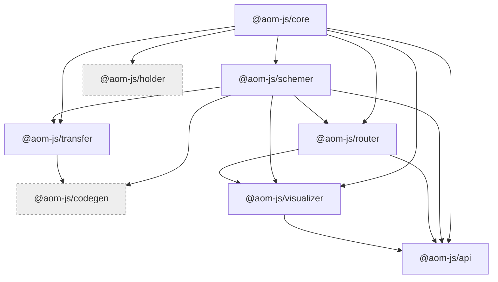
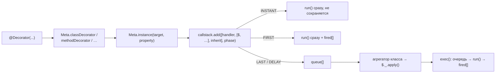
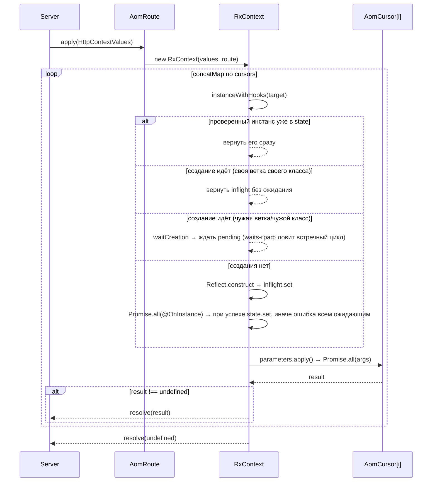

# Архитектура ядра aom.js

Обзор монорепо `@aom-js/*`: состав пакетов, их зависимости, общая модель метаданных, путь от класса-контроллера до HTTP-сервера и документа OpenAPI, сборка и потребление ядра приложением, правила правки ядра.
Документ — точка входа: механика каждого пакета описана в его `readme.md`, здесь только карта и сквозные вещи. Ядро и приложение лежат соседними каталогами `main/` и `test/` одного рабочего пространства; в текстах ядра пути даются от корня ядра, ссылки на приложение — с префиксом `test/`.
Читать после: `packages/core/readme.md`, `packages/router/readme.md`, `test/docs/architecture.md`. Термины — `test/docs/README.md#словарь`.

## Состав монорепо и граф зависимостей

Монорепо — `bun`-workspaces с единственным шаблоном `packages/*` (`package.json` (`workspaces`)). Пакет — каталог `packages/<pkg>`; все публикуются под скоупом `@aom-js`.

| Пакет                | Версия | Назначение                                                                    | Зависит от                        | Кем используется                                   | Используется приложением                                       |
| -------------------- | ------ | ----------------------------------------------------------------------------- | --------------------------------- | -------------------------------------------------- | -------------------------------------------------------------- |
| `@aom-js/core`       | 0.0.4  | Реестр мета-инстансов и фабрики legacy-декораторов с отложенным исполнением   | —                                 | schemer, router, transfer, holder, visualizer, api | да (`test/src/modules/tickets/api/routes/tickets/init/aom.ts`) |
| `@aom-js/schemer`    | 0.0.11 | Класс = DTO + JSON Schema + валидация; сборщик компонентов                    | core                              | router, transfer, visualizer, api, codegen         | да                                                             |
| `@aom-js/router`     | 0.0.1  | Карта HTTP/WS-маршрутов из классов-контроллеров и её исполнение               | core, schemer                     | visualizer, api                                    | да (зонды — `@aom-js/router/testing`)                          |
| `@aom-js/api`        | 0.0.1  | HTTP-сервер на `node:http`, билдеры, базовые контроллеры, ответы, локализация | core, schemer, router, visualizer | —                                                  | да                                                             |
| `@aom-js/transfer`   | 0.0.7  | Изоляторы/исполнители и RPC поверх абстрактной шины                           | core, schemer                     | codegen                                            | да                                                             |
| `@aom-js/holder`     | 0.0.1  | Отложенное применение сторонних декораторов на конечном потомке               | core                              | —                                                  | нет (симлинк есть, импортов нет)                               |
| `@aom-js/codegen`    | 0.0.1  | Генерация исходников aom-классов из дескриптора изолятора                     | schemer, transfer                 | —                                                  | нет (симлинк есть, импортов нет)                               |
| `@aom-js/visualizer` | 0.0.1  | Граф API по дереву контроллеров и его рендер в самодостаточную HTML-страницу  | core, schemer, router             | api                                                | нет (используется через `BaseVisualizerController` из api)     |

Версии — из `packages/<pkg>/package.version.json`, зависимости — из `packages/<pkg>/package.src.json` (`dependencies`, ссылки внутри монорепо — `workspace:*`). Сколько файлов приложения импортирует пакет — `grep -rl "@aom-js/<pkg>" test/src | wc -l` из корня рабочего пространства.



Пунктиром — пакеты, которые приложение не потребляет ни напрямую, ни через другие пакеты.

Внешние зависимости:

| Пакет        | Внешние runtime-зависимости                                                              |
| ------------ | ---------------------------------------------------------------------------------------- |
| `core`       | нет (`dependencies: {}`)                                                                 |
| `schemer`    | `class-transformer`; `class-validator`; `class-validator-jsonschema`; `reflect-metadata` |
| `router`     | `openapi3-ts`; `reflect-metadata`; `rxjs`                                                |
| `api`        | `ws`; `dayjs`; `es-toolkit`; `reflect-metadata`                                          |
| `transfer`   | `rxjs`; `reflect-metadata`                                                               |
| `holder`     | `reflect-metadata`                                                                       |
| `codegen`    | нет внешних (только `@aom-js/schemer`, `@aom-js/transfer`)                               |
| `visualizer` | `reflect-metadata`                                                                       |

`core` действительно свободен от внешних зависимостей, но общий набор шире, чем предполагали черновики (см. «Расхождения с историческими заметками»).

Граф раскладывается на три слоя. Внизу — `core`: механизм метаданных, ничего не знающий ни про HTTP, ни про схемы. Средний слой — три независимые друг от друга специализации этого механизма: `schemer` (описание данных), `router` (карта и исполнение маршрутов, поверх `schemer` ради компонентов OpenAPI) и `transfer` (межпроцессные вызовы). Наверху — потребители: `visualizer` строит из дерева контроллеров `router` граф API, `api` собирает из `router` работающий сервис (страницу графа отдаёт его `BaseVisualizerController`), `codegen` из `transfer`+`schemer` — исходники клиента. `holder` стоит сбоку: он расширяет `core` и ни от кого больше не зависит.

## Модель метаданных AomCore

Под всеми пакетами лежит один механизм. Мета-класс (`AomCore` и наследники) — это реестр: каждый наследник получает собственную `WeakMap` инстансов и собственные фабрики декораторов. Прикладные поля объявляются прямо в наследнике, служебная часть живёт в узле.

- **Мета-инстанс** (`$`) — `Meta.instance(target, property?)`: экземпляр мета-класса, привязанный к классу или к его свойству/методу (`packages/core/src/defines/core.ts` (`AomCore.instance`)). Ключ реестра для метода — сам `descriptor.value`, для поля без дескриптора — синтетический инстанс из карт `properties`/`statics` (`core.ts` (`AomCore.instanceKey`)).
- **Узел** (`$._`, класс `AomNode`) — `target`, `property`, `root` (узел класса), карты `properties`/`statics`, список `origins` и `callstack` (`packages/core/src/defines/node.ts` (`AomNode`)). Не экспортируется.
- **Фаза** (`ExecutionPhase`) — `INSTANT`, `FIRST`, `LAST`, `DELAY` (`packages/core/src/defines/types.ts` (`ExecutionPhase`)). `FIRST` выполняется в момент декорирования и запоминается в `fired`; `LAST` и `DELAY` копятся в очереди до `apply()`; `DELAY` дополнительно уходит в `setTimeout`; `INSTANT` выполняется сразу и **нигде не сохраняется** (`packages/core/src/defines/callstack.ts` (`AomCallstackQueue.add`)).



Фабрики декораторов — пять штук: `classDecorator`, `combinedDecorator`, `methodDecorator`, `propertyDecorator`, `parameterDecorator` (`core.ts` (`AomCore.classDecorator`, `AomCore.combinedDecorator`, `AomCore.methodDecorator`, `AomCore.propertyDecorator`, `AomCore.parameterDecorator`)). Все устроены одинаково — получить инстанс и положить ленивый вызов в очередь фазы:

`packages/core/src/defines/core.ts` (`AomCore.classDecorator`)

```ts
static classDecorator<T extends AomCore>(
  this: AomClass<T>,
  handler: AomHandler<T>,
  storeFlag: ExecutionPhase = ExecutionPhase.FIRST,
  inherit?: InheritPlacement,
): ClassDecorator {
  const self = this; // t теперь типа AOMClass<T>
  return function (target: ClassType) {
    // Получаем AOM-инстанс для этого конструктора
    const targetInstance = self.instance(target);
    return targetInstance._.callstack.add([handler, [targetInstance], inherit], storeFlag);
    // Классные декораторы могут возвращать конструктор, но здесь мы только для сайд-эффекта
  };
}
```

**Агрегатор** — класс-декоратор в фазе `INSTANT`, который «закрывает» класс: наследует callstack родителей и запускает накопленные отложенные вызовы. У router это `@Controller()`:

`packages/router/src/decorators/controllers/index.ts` (`Controller`)

```ts
export function Controller() {
  return AomApi.classDecorator(($) => {
    $.element.isController = true;
    // ...
    const inheritDecorators = (parent: ClassType) => {
      const $parent = $._.inherit(parent);
      // ...
    };
    inheritDecorators(Object.getPrototypeOf($._.target));
    $._.apply(); // вызовем собственные отложенные декораторы
  }, ExecutionPhase.INSTANT);
  // этот декоратор не сохраняем, чтобы не вызывать рекурсии при переносе
}
```

Аналоги: `@ComponentSchema` у schemer (`packages/schemer/src/defines/decorators.ts` (`ComponentSchema`)), `@Isolator` у transfer, `@Apply`/`@Delay` у holder. Отложенная сторона — декораторы `LAST`, которые на момент своего вызова ещё не знают итогового класса: типичный пример — фабрики `PropertySchema.*`, навешивающие библиотечные декораторы `class-validator` только при `apply()` (`packages/schemer/src/defines/properties.ts` (`_String`)).

`packages/schemer/src/defines/properties.ts` (`_String`) (сокращённо)

```ts
const _String = (params: StringDescriptionsProperties): PropertyDecorator => {
  //
  return AomSchemas.propertyDecorator(($) => {
    checkExistsSchemaParams($);
    $.schemaName = SchemaTypes.STRING;
    $.schemaParams = params;

    const { originInstance, property } = $._;

    const decorators = [
      IsString({ ... }),
      params.isOptional ? IsOptional() : undefined,
      // ...
      ...(params.decorators || []), // добавим дополнительные декораторы
    ];

    // применим соответствующие декораторы
    decorateProperty(decorators, originInstance, property);
  }, ExecutionPhase.LAST);
};
```

Сырые `schemaName`/`schemaParams` остаются в мета-инстансе свойства — на них держатся mapped-types (см. «Роль schemer»).

**Наследование** — `$._.inherit(parent)` (`packages/core/src/defines/node.ts` (`AomNode.inherit`)): callstack родителя переносится на потомка с подменой первого аргумента (`transferTo`, `packages/core/src/defines/callstack.ts` (`AomCallstackQueue.transferTo`)), а декорированные статики и прототипные методы копируются на потомка **каррированной обёрткой**, чтобы у потомка появился собственный ключ реестра и собственный мета-инстанс; копия пробрасывает вызывающей стороне её `this`, а не фиксирует его на `null` (`packages/core/src/defines/node.ts` (`AomNode.inherit`), `KI-CORE-05`). Повторный `inherit(parent)` того же родителя идемпотентен — `WeakSet` уже унаследованных родителей не даёт повторно выполнить его FIRST-очередь (`packages/core/src/defines/node.ts` (`AomNode.inherit`, `AomNode.inherited`), `KI-CORE-07`). Размещение переноса задаёт `InheritPlacement`: `APPEND` (по умолчанию), `PREPEND` (блоком в начало очереди, осмыслен только для отложенных фаз) и `SKIP` (`packages/core/src/defines/callstack.ts` (`AomCallstackQueue.transferTo`)). Декораторы параметров конструктора переносятся, только если у потомка нет своих (см. `packages/core/readme.md` §«Наследование…»; `KI-CORE-10` в `test/docs/known-issues.md`).

`AomCore.resolveFor($, context)` доразрешает ссылку на статику родителя в мета-инстанс каррированной копии потомка (`core.ts` (`AomCore.resolveFor`)): ссылка вида `@Before(Self.Method)` вычисляется до `@Controller()` потомка и фиксирует мета-инстанс **родителя**, и без доразрешения отложенный `ThisRef` реализовался бы на классе без унаследованных значений (у билдеров api — без `static schema`). Router зовёт его в конструкторе курсора и в `Before`/`After`/`UseMarker`/`Next` (`packages/router/src/common/cursor.ts` (`AomCursor`), `packages/router/src/decorators/middlewares/index.ts` (`Before`, `After`, `UseMarker`, `Next`)); отложенный стек метода курсор реализует один раз на мета-инстанс и взводит `AomApi.delayRealized` только при успехе — при ошибке стек не расходуется и ошибка повторяется на следующей сборке (`cursor.ts` (`AomCursor.realizeDelay`)). Паттерн закрепляет `packages/router/test/inherited-static-refs.test.ts`; механика — `packages/core/readme.md` §«`resolveFor`».

`INSTANT`-вызовы нигде не сохраняются (ни в `queue`, ни в `fired`) и потому не переносятся на потомка при `inherit()` — это особенность, а не дефект: агрегаторы `@Controller()`/`@ComponentSchema()`/`@Delay`/`@Apply` вызывают `$._.inherit()`/`$._.apply()` и объявлены в фазе `INSTANT` именно затем, чтобы не сохраняться — иначе перенос на потомка повторил бы агрегатор и увёл бы в рекурсию. Evidence: `packages/core/src/defines/callstack.ts` (`AomCallstackQueue.add`) (ветка `INSTANT` только вызывает `run(value)`); характеризационный тест — `packages/core/test/phases.test.ts` («INSTANT выполняется немедленно и не сохраняется в очередях»). См. `KI-CORE-04` в `test/docs/known-issues.md`.

Механика реестра, фаз, каррирования и `resolveFor` целиком — `packages/core/readme.md` §«Ключевые механизмы».

Мета-классы по пакетам:

| Мета-класс         | Пакет      | Файл                                                                           | Что хранит                                                                         |
| ------------------ | ---------- | ------------------------------------------------------------------------------ | ---------------------------------------------------------------------------------- |
| `AomApi`           | router     | `packages/router/src/common/api.ts` (`AomApi`)                                 | `element` (роль метода, бриджи, миддлвари, маркеры, хуки), `openApi`, `delayStack` |
| `AomSchemas`       | schemer    | `packages/schemer/src/defines/module.ts` (`AomSchemas`)                        | `isComponentSchema`, `schemaName`/`schemaParams`, `connections`, `properties`      |
| `AomIsolator`      | transfer   | `packages/transfer/src/defines/main.ts` (`AomIsolator`)                        | описание изолятора, топики, дескриптор дистрибуции                                 |
| `AomHolder`        | holder     | `packages/holder/src/init.ts` (`AomHolder`)                                    | `queue: CombinedDecorator[]`                                                       |
| `AomAccessCore`    | api        | `packages/api/src/controllers/access/types.ts` (`AomAccessCore`)               | точки и типы доступа маршрута                                                      |
| `TicketsTypeRelay` | приложение | `test/src/modules/tickets/api/routes/tickets/init/aom.ts` (`TicketsTypeRelay`) | `required_type: ITicketTypeMetaData[]`                                             |

`TicketsTypeRelay` — единственное место, где приложение импортирует `@aom-js/core` напрямую: прикладной мета-класс объявляется тем же способом, что и мета-классы ядра.

## Как router строит и исполняет маршруты

`new Router(root, docs)` рекурсивно обходит бриджи от корневого класса, а собранные маршруты регистрирует в документе OpenAPI (`packages/router/src/classes/router.ts` (`Router.constructor`)). На каждом уровне классовые `@Before` превращаются в курсоры и проталкиваются в дочерние бриджи, классовые `@After` — не проталкиваются и добавляются только к эндпоинтам текущего уровня (`router.ts` (`Router.build`)).

Для каждого эндпоинта создаётся `AomRoute`, который раскладывает курсоры в плоский список: `plain()` для каждого курсора сначала рекурсивно раскладывает его `pre_middlewares`, потом кладёт сам курсор, потом `post_middlewares`, потом `@Next` (`packages/router/src/common/route.ts` (`plain`)). Сам эндпоинт добавляется последним элементом входного списка (`packages/router/src/common/route.ts` (`AomRoute.constructor`)), после чего по всем курсорам прогоняются `@Marker`-обработчики в контексте объявившего их класса (`packages/router/src/common/route.ts` (`AomRoute.constructor`)).

При создании курсора происходят две вещи: перепривязка `$` к классу-потомку через `AomApi.resolveFor` и однократная реализация отложенного стека `delayStack` (`ThisRef`/`RouteRef`/`FwdRef`) с последующим `$._.apply()` (`packages/router/src/common/cursor.ts` (`AomCursor.constructor`, `AomCursor.realizeDelay`)). Отложенные ссылки нужны там, где декоратор объявлен на базовом классе, а значение известно только у потомка или у конечного маршрута — на этом построены билдеры `@aom-js/api`.

Механика ссылок минимальна: `FwdRef(fn)`, `ThisRef(fn?)` и `RouteRef(fn?)` заворачивают функцию в контейнер (`packages/router/src/specials/references.ts` (`FwdRef`, `ThisRef`, `RouteRef`)), у контейнера единственный метод `exec(constructor)`, применяющий функцию к переданному классу; у `FwdContainer` аргументов нет вовсе (`packages/router/src/common/references.ts` (`RefContainer.exec`)). Декоратор `DelayRefStack(container)` просто складывает контейнер в `$.delayStack` метода (`packages/router/src/decorators/references/index.ts` (`DelayRefStack`)). Разворачивает стек курсор: `FwdContainer` вызывается без контекста, `ThisRefContainer` получает класс курсора, `RouteRefContainer` — класс эндпоинта, и результат каждого применяется через `Reflect.decorate` (`packages/router/src/common/cursor.ts` (`AomCursor.realizeDelay`)).

Исполнение: `route.apply(context)` создаёт `RxContext` (значения запроса + `state: ClassInstanceMap` проверенных инстансов) и через `rxjs` `concatMap` последовательно проходит курсоры (`packages/router/src/common/route.ts` (`AomRoute.apply`), `packages/router/src/common/context.ts` (`RxContext.run`)). Перед вызовом каждого метода рантайм безусловно зовёт `AomApi.instanceWithHooks(target, ...)` для класса-владельца курсора (`packages/router/src/common/api.ts` (`AomApi.instanceWithHooks`)); создание и проверка идут в две стадии — до конца хуков `@OnInstance` инстанс виден только своей ветке исполнения через `RxContext.inflight`, и лишь после их успеха переносится в `state` (`packages/router/src/common/api.ts` (`AomApi.instanceWithHooks`)) — затем `Promise.all` собирает аргументы из обработчиков параметров (в том числе разворачивая ленивые значения контекста, см. ниже), затем вызывается статический метод. Первый результат `!== undefined` завершает цепочку и становится ответом; `Error` — возвращённый или брошенный — уходит в `reject`.



Было (дефект): аргументы метода решаются конкурентно через `Promise.all`, а `@This` делал асинхронный check-then-create по `context.state` без дедупликации — два `@This(X)` в одном методе создавали два инстанса `X` и вызывали `@OnInstance` дважды. Исправлено 2026-09-14: идущее создание запоминается в `context.pending` (`Map<ClassConstructor, Promise>`). На том же месте нашёлся следующий дефект (`KI-ROUTER-16`, `KI-ROUTER-17`): та версия фикса публиковала инстанс в `state` сразу после конструктора, ещё до хуков — окно, в котором чужой код (параллельная ветка, `@This` из хука другого класса) получал непроверенный объект, если хук потом отказывал (реальный сценарий — обход авторизации). Исправлено 2026-09-21: инстанс до конца хуков лежит в `context.inflight` и виден только собственному коду создающего его класса (его хук через `@This()`, его же middleware через `@Run()`-`next()`), в `state` попадает только после успешных хуков; чужая ветка, наткнувшаяся на чужое создание, не плодит второй инстанс, а ждёт тот же `pending`-промис через `context.waitCreation`, регистрируя ожидание в карте `waits`. Класс, наткнувшийся на цикл — свой код внутри создания другого класса, взаимные хуки, конструктор↔хук, встречное ожидание двух веток — получает `CIRCULAR_INSTANCE_ERROR` с именами классов цепочки, а не зависший запрос или `RangeError: Maximum call stack size exceeded`. Отказ конструктора или хука по-прежнему запоминается в `pending` до конца запроса — следующие обращения к классу получают ту же ошибку, а не создают его заново. Evidence: `packages/router/src/common/api.ts` (`AomApi.instanceWithHooks`), `packages/router/src/common/context.ts` (`RxContext.waitCreation`); тесты `packages/router/test/router-instance-safety.test.ts`, `packages/router/test/router-exec.test.ts` («два @This одного класса в одном методе дают один инстанс и один вызов @OnInstance», «класс, нужный методу и конструктору другого @This-класса, создаётся один раз», «курсор класса, чьё создание уже идёт, ждёт готового инстанса», «перехваченная ошибка хука-проверки не пускает следующий курсор того же класса без авторизации»). Подробности, известное ограничение (`waits` держит одно ребро на ожидающую ветку) и ломающее изменение для паттерна «хук зовёт `next()` помощника, а тот берёт `@This` на вызывающий класс» — `packages/router/readme.md` §«Инстансы, `state` и `@OnInstance`…». Рабочие примеры прикладного кода («как писать так, чтобы это не сломалось») — `docs/cookbook/this-and-instances.md`.

Значения контекста запроса (`query`, `params`, `cookies`, `headers`, `session`) необязательно готовы заранее: `HttpContextValues` принимает либо значение, либо `lazy(() => ...)` (`Lazy<T> = T | LazyValue<T>`, `packages/router/src/common/lazy.ts`); `body`/`files` остаются `any`, но по тому же контракту принимают `lazy(...)`. `RxContext.value(key)` разворачивает обёртку не раньше первого обращения к соответствующему `@Body`/`@Query`/… и не больше одного раза за запрос — параллельные обращения (например, два `@Body` в одном методе) получают один и тот же промис, отказ фабрики тоже запоминается (`packages/router/src/common/context.ts` (`RxContext.value`)). Смысл — не платить за дорогое значение (разбор тела запроса), если до него не дошли: например, когда проверка доступа отказала раньше по цепочке курсоров. Выигрыш держится только пока такие проверки идут раньше `@Body` в списке курсоров и сами его не трогают — подробности и адаптерный контракт (никакого отдельного интерфейса, кроме `HttpContextValues` + `LazyValue`) — `packages/router/readme.md` §«Ленивые значения контекста…».

> ⚠️ Дефект: классовый `@After` исполняется **до** эндпоинта, а не после.
> Evidence: `packages/router/src/classes/router.ts` (`Router.build`) (`postCursors` попадают в общий список курсоров наравне с `preCursors`) и `packages/router/src/common/route.ts` (`AomRoute.constructor`) (курсор эндпоинта добавляется последним). После эндпоинта идут только методные `@After`, которые `plain()` раскладывает вокруг самого курсора эндпоинта (`packages/router/src/common/route.ts` (`plain`)).
> Последствия: постобработка, объявленная на классе, видит состояние до вызова обработчика. Особенность, открытый вопрос закрыт — оставлено как есть.
> См. `KI-ROUTER-02` в `test/docs/known-issues.md`.

Порядок курсоров, `RxContext.run`, состояние и `@This`, отложенные ссылки, маркеры и `OpenApi.registerPath` подробно — `packages/router/readme.md` §«Ключевые механизмы». Итоговый порядок шагов маршрута и класс, на котором исполняется каждый шаг, в уме не выводятся: их даёт проекция цепочки (`Router.routeOf`, `toJSON`, `@CursorKind`) — [`packages/router/readme.md` §«Метаданные цепочки…»](../packages/router/readme.md#метаданные-цепочки-tojson-routeof-cursorkind).

## Роль schemer

`@aom-js/schemer` даёт правило «один класс — и DTO, и JSON Schema, и валидатор». Класс помечается `@ComponentSchema()`, свойства — фабриками `PropertySchema.String/Number/Boolean/Date/Enum/Any/Type` (`packages/schemer/src/defines/properties.ts` (`PropertySchema`), экспорт — `packages/schemer/src/index.ts` (`PropertySchema`)). Двухфазность обязательна: `@ComponentSchema` работает в `INSTANT` и внутри себя вызывает `$._.inherit(...)` и `$._.apply()` (`packages/schemer/src/defines/decorators.ts` (`ComponentSchema`)), а фабрики свойств — в `LAST` и потому навешивают библиотечные декораторы `class-validator`/`class-transformer` уже после того, как класс собран (`packages/schemer/src/defines/properties.ts` (`_String`)).

Побочный эффект того же дизайна — mapped-types: `PartialType`, `PickType`, `OmitType`, `IntersectionType` пересобирают класс, повторно вызывая `PropertySchema[schemaName](schemaParams)` из сохранённых сырых параметров (`packages/schemer/src/defines/mapped-types/`).

`SchemasCollector` — общий сервис ядра: превращает `@ComponentSchema`-классы в `$ref` и рекурсивно собирает рендеры в `Map components`, понимая скаляры по имени и конструктору (`packages/schemer/src/defines/collector.ts` (`SCALAR_SCHEMAS`, `SCALAR_TYPE_SCHEMAS`) — словари, `packages/schemer/src/defines/collector.ts` (`SchemasCollector.extract`) — `extract`). Его потребляют router (`components.schemas` документа OpenAPI, `packages/router/src/classes/openapi.ts` (`OpenApi.toJSON`)), transfer (дескрипторы изоляторов), api (`SafeData`, билдеры) и codegen (обратное восстановление классов).

Было (дефект): `minValue`/`maxValue`/`minLength`/`maxLength` со значением `0` игнорировались truthy-проверкой (`params.maxLength ? ... : undefined`) — `minValue: 0` не попадал ни в валидатор, ни в схему. Исправлено 2026-09-14: сравнение `!= null` в 4 местах (`packages/schemer/src/defines/properties.ts` (`_String`) — String, `packages/schemer/src/defines/properties.ts` (`_Number`) — Number); тест `packages/schemer/test/render.test.ts` («minValue: 0 попадает в схему как minimum: 0») — обычный, без `it.fails`. См. `KI-SCHEMER-01` в `test/docs/known-issues.md`.

Параметры `PropertySchema.*`, набор библиотечных декораторов, mapped-types, `Schemer.validate` — `packages/schemer/readme.md`.

## api: Server и батарейки

`@aom-js/api` — прикладной слой поверх router: всё, что нужно, чтобы из карты маршрутов получить работающий сервис. Ядро пакета — `Server` (`packages/api/src/server/http.ts` (`Server`)): оборачивает `node:http`, строит `RouteMatcher` по `router.routes`/`router.sockets` (`http.ts` (`Server.constructor`)), разбирает адрес запроса через `parseRequestUrl` (`http.ts` (`parseRequestUrl`), см. дефект ниже), парсит query/headers/cookies и тело (`content-type` — по части до `;`, без учёта регистра: `charset=utf-8` не мешает, `packages/api/src/server/body.ts` (`parseJsonBody`)), вызывает `route.apply(...)` и сериализует результат: строка → `text/plain; charset=utf-8`, если обработчик не выставил `Content-Type` сам (`KI-API-17`), `Readable` → `stream.pipeline` (источник разрушается при ошибке/обрыве клиента), `ErrorMessage`/чужая ошибка → безопасный статус 200–999 через единый `catch`, иначе JSON 200 (`http.ts` (`Server.constructor`)). Запросы `upgrade` уходят в socket-маршруты той же схемой разбора адреса (`http.ts` (`Server.constructor`)). `I18nizer` подменяет коды сообщений на локализованный текст уже в сериализованном ответе (`packages/api/src/server/i18nizer.ts` (`I18nizer.localize`)).

Билдеры (`BodyBuilder`, `QueryStringBuilder`, `HeadersBuilder`, `CookieBuilder`, `ParamsBuilder`, `ResponseBuilder`) — фабрики контроллеров из класса-схемы: наследник получает `static schema`, а базовый класс через `ThisRef`+`DelayRefStack` забирает схему потомка, валидирует данные и кладёт результат в поле инстанса, попутно регистрируя описание OpenAPI (`packages/api/src/builders/query-string.ts` (`SafeOriginParameters`, `QueryStringBuilderConstructor.Query`), `packages/api/src/builders/common.ts` (`PlainBuildersBase.JSONSchema`); состав barrel-а — `packages/api/src/builders/index.ts`). Именно этот паттерн и потребовал `resolveFor` (см. «Модель метаданных AomCore»).

| Батарейка                                      | Что даёт                                                                    | Как настраивается                                                                                                                                                               | Где в приложении                                         |
| ---------------------------------------------- | --------------------------------------------------------------------------- | ------------------------------------------------------------------------------------------------------------------------------------------------------------------------------- | -------------------------------------------------------- |
| `BaseRootController`                           | индекс маршрутов модуля, `/openapi.json`, `/swagger.html`                   | наследование + `readonly docs`, `RoutesStructure` (`packages/api/src/controllers/root.ts` (`BaseRootController`))                                                               | `test/src/common/controllers/module/controller.ts`       |
| `BaseAccessController`                         | маркеры доступа на маршрутах, `TypesRequired`/`ExtraAccess`, карта доступов | статики `markerName`, `allowedAccessTypes`, `AccessMarker`, `AccessCore` (`controllers/access/access-controller.ts` (`BaseAccessController`))                                   | `test/src/common/controllers/access/controller.ts`       |
| `AuthBasic`                                    | basic-авторизация для служебных маршрутов                                   | `static BASIC_AUTH` (`controllers/auth/basic.ts` (`AuthBasic`))                                                                                                                 | `test/src/config/aom/auth.ts`                            |
| `AuthHeaderToken` / `AuthCookieToken`          | извлечение токена из заголовка/куки                                         | `TOKEN_NAME`, `HEADERS_KEYS` (`controllers/auth/headerToken.ts` (`AuthHeaderToken`)); у куки своя статика `COOKIE_NAME` (`controllers/auth/cookieToken.ts` (`AuthCookieToken`)) | `test/src/config/aom/auth.ts`                            |
| `IDController` / `IDValue` / `UUIDParam` и др. | типизированный path/query/header-параметр идентификатора                    | фабрика `IDValue(attr, IDPattern)` (`controllers/id-value/controller.ts` (`IDValue`))                                                                                           | `test/src/modules/*/api/routes/*/init/controllers/id.ts` |
| `Logger`                                       | журналирование маршрута и курсоров                                          | `static ENGINE` (`controllers/logger/logger.ts` (`Logger.ENGINE`))                                                                                                              | `test/src/config/aom/logger.ts` (`ENGINE = pino`)        |
| `I18nizer`                                     | локализация кодов сообщений в ответе                                        | `DEFAULT_LOCALE`, `HEADER_KEY`, `QUERY_KEY`                                                                                                                                     | `test/src/config/aom/i18nizer.ts`                        |

Ответы — `ErrorMessage` (Error + `toJSON` + `JSONSchema`, `packages/api/src/responses/error-message.ts` (`ErrorMessage`)) и семейство `*Response` со статусами 303–500: `SeeOtherResponse`, `AuthRequiredResponse`, `PaymentRequiredResponse`, `AccessDenyResponse`, `NotFoundResponse`, `ConflictResponse`, `WrongDataResponse`, `LockedResponse`, `FailedDependencyResponse`, `PayloadTooLargeResponse`, `ServerErrorResponse`, `ErrorWithStatusResponse` (`packages/api/src/responses/error-responses.ts` (`SeeOtherResponse`, `AuthRequiredResponse`, `PaymentRequiredResponse`, `AccessDenyResponse`, `NotFoundResponse`, `ConflictResponse`, `WrongDataResponse`, `LockedResponse`, `FailedDependencyResponse`, `PayloadTooLargeResponse`, `ServerErrorResponse`, `ErrorWithStatusResponse`)). Успешные — `CommonResponse`, `MessageResponse`, `DataResponse`, `NumberResponse`, `BooleanResponse`, `StringResponse` (`packages/api/src/responses/data-responses.ts` (`CommonResponse`, `MessageResponse`, `DataResponse`, `NumberResponse`, `BooleanResponse`, `StringResponse`)).

Пакет прошёл ревью и три раунда аудита безопасности (2026-09-14): было — не покрыт тестами и не подключён к тестовому окружению монорепо (`KI-API-11`); исправлено — алиас `@aom-js/api` добавлен в `vitest.config.ts` (`resolve.alias`), тесты `packages/api/test/*.test.ts` покрывают `Server`/`RouteMatcher`, `checkLocales`, `BodyBuilder.JSONSchema`, коды 423/424 и `CheckLayerPass` (прогон — `bunx vitest run packages/api`). Заодно закрыты `KI-API-02` (частично), `KI-API-03, 04, 05, 06, 08, 12, 13`; `KI-API-01` и `KI-API-09` — решения автора (валидатор параметра пути и так встроен в regexp; коды ошибок ядра и SSE оставлены как есть).

Отдельно аудит нашёл и закрыл разбор адреса запроса: было — `/../..` ронял процесс (HIGH), затем authority-form (`//evil.com/admin`), абсолютная форма (`http://evil.com/admin`) и обратный слэш (WHATWG считает его тем же `/`) позволяли хосту из запроса подменить путь маршрутизации в обход фильтра прокси/WAF (MEDIUM); исправлено — `parseRequestUrl` (`http.ts` (`parseRequestUrl`)) фиксирует хост константой и меняет только `pathname`/`search` через сеттеры, минуя общий алгоритм разрешения относительных ссылок. Также закрыт баг с многобайтовым UTF-8 на границе TCP-чанков в теле запроса (`packages/api/src/server/body.ts` (`parseJsonBody`), сборка через `Buffer`). Оба вопроса, остававшихся к автору, закрыты 2026-09-21: тело запроса теперь читается лениво и с лимитом размера (`KI-API-16` — `packages/api/src/server/body.ts` (`parseJsonBody`), по умолчанию 1 МиБ, переопределяется `AomServerSettings.bodyLimit` и декоратором `@BodyOptions`), а строковый результат обработчика по умолчанию уходит как `text/plain`, чтобы браузер не исполнял попавшие в него данные как разметку (`KI-API-17` — `http.ts` (`Server`)).

См. `KI-API-03, 11, 14, 15, 16, 17` в `test/docs/known-issues.md`.

`Server`, `RouteMatcher`, `I18nizer`, билдеры, `BaseRootController`, `BaseAccessController`, auth-middleware, `IDController`, ответы и `Logger` — `packages/api/readme.md`.

## transfer: изоляторы и исполнители

`@aom-js/transfer` реализует «изоляторы»: класс со статическими методами помечается `@Isolator(transfer)` (фаза `INSTANT`, как и другие агрегаторы — `KI-CORE-04`), а его методы через `@ResponseTopic`/`@CustomTopic` подменяются на публикацию сообщения в топик `${Class}.${method}` (`packages/transfer/src/defines/decorators.ts` (`ResponseTopic`, `CustomTopic`) — объявление, `packages/transfer/src/defines/decorators.ts` (`AutoTopic`) — `AutoTopic`, замена `descriptor.value`). Исполнитель — наследник с `@Executor(instanceId?)` (тоже `INSTANT`), который подписывается на топик, выполняет собственную реализацию и отвечает в reply-топик вызывающего (`decorators.ts` (`Executor`) — `Executor`, `packages/transfer/src/defines/decorators.ts` (`attachIsolation`) — `attachIsolation`). Транспорт абстрактен: класс `Transfer` получает пару колбэков publisher/subscriber, имя/ключ инстанса и опции `responseTimeout`/`defaultErrorHandler`, из которых строятся reply-топики и таймаут ответа (`packages/transfer/src/defines/main.ts` (`Transfer.constructor`)).

Дедупликация и конверты ошибок живут в `RxTransfer`: карта `uniqKey → callback`, сериализуемый конверт `{name, message, status, data}` и дедупликация синглтонов по sha256 аргументов, ключ процесса строится из `instanceTopic` (адрес `toInstance`, если задан) — `KI-TRANSFER-03` (`packages/transfer/src/defines/rx-transfer.ts` (`RxTransfer.request`) — `request`, `packages/transfer/src/defines/rx-transfer.ts` (`callbackObserver`) — `callbackObserver`).

Вторая половина пакета — дистрибуция: `@TopicSchema` описывает схемы аргументов и ответа, опция `@Isolator(transfer, { distributed: true })` (заменила отдельный `@IsDistributed()`, зависимость от порядка декораторов исчезла — `KI-TRANSFER-07`) собирает сериализуемый `TransferServiceDescriptor` (`decorators.ts` (`distribute`)), `Transfer.collectDistributions` опрашивает шину системными топиками, `Transfer.restore(descriptor)` строит вызывающий прокси без исходного класса (`main.ts` (`Transfer.collectDistributions`, `Transfer.restore`)). Это задел под codegen; приложение использует только `Transfer`, `Isolator`, `Executor`, `ResponseTopic`, `CustomTopic`.

Контракт, RPC, reply-топики, дедупликация синглтонов, дистрибуция и `MemoryBus` — `packages/transfer/readme.md`.

## holder и codegen

`@aom-js/holder` — три декоратора поверх `AomCore` (`Hold`, `Delay`, `Apply`), которые копят сторонние декораторы свойств на предке и применяют их только на конечном потомке (`packages/holder/src/decorators.ts` (`Hold`, `Delay`, `Apply`); мета-класс — `packages/holder/src/init.ts` (`AomHolder`)). Замысел (`docs/holder.md`) — не создавать в БД базовые сущности с `PropertySchema`/MikroORM-декораторами. Пакет остаётся черновиком: приложением не импортируется, но ключевой сценарий теперь работает (`KI-HOLDER-01` закрыт).

`@Delay`/`@Apply` работают в фазе `INSTANT` (так и задумано, `KI-CORE-04`); до исправления они сами не переносили `$.queue` родительского `AomHolder`-инстанса при `inherit()` — класс-декораторы родителя, поставленные через `@Delay`, до потомка не доезжали. Исправлено: перед вызовом `inherit()` `Delay` переносит `$.queue` родителя через `unshift` (`packages/holder/src/decorators.ts` (`Delay`)), а `WeakSet` (`decorators.ts` (`queueInherited`)) защищает от повторного переноса при вызове `Delay` из `Apply`. Тесты — `packages/holder/test/holder.test.ts` («Delay на родителе + Apply на потомке переносит класс-декораторы родителя») (двухуровневый перенос, раньше был `it.fails`, теперь проходит как обычный), `packages/holder/test/holder.test.ts` («трёхуровневая цепочка Delay/Delay/Apply переносит очередь прародителя и родителя») (трёхуровневая цепочка дед/родитель/потомок). См. `KI-HOLDER-01` в `test/docs/known-issues.md`.

`@aom-js/codegen` — генерация исходников aom-классов из `TransferServiceDescriptor`: чистые функции `collect`, `emitSchemas`, `emitIsolator`, `emitService`, `planGeneration`, `diffManifest` (`packages/codegen/src/index.ts`) и CLI `aom-codegen` с командами `collect`/`generate`/`check`. Файловой системой занимается только CLI. Схемы компонентов восстанавливаются не из JSON Schema, а из собственного формата свёртки `FoldedSchemas`, который несёт дескриптор (`@aom-js/schemer` — `foldSchemas`); дескриптор приходит с общей шины (недоверенные данные), поэтому развёртка (`emit-schemas.ts`, `emit-isolator.ts`) проходит через явную границу проверок (`safe.ts`) — имена компонентов/enum/сервиса/метода, `$date`/`$regexp`/`$validator`/`$ref` и пути каталогов не долетают до генерируемого кода без проверки. После ревью и четырёх раундов аудита безопасности (2026-09-14) CLI-bin получает бит `+x` при сборке, `check` сообщает об удалённых из снапшота сервисах.

Подробности — `packages/holder/readme.md` и `packages/codegen/readme.md` (формат свёртки, безопасность генерации, `KI-CODEGEN-01…05`).

## Сборка, тесты и инструменты монорепо

**Сборка.** `bun run build` собирает пакеты строго по графу зависимостей и заканчивается smoke-проверкой: `build:core → build:schemer → build:router → build:transfer → build:codegen → build:holder → build:visualizer → build:api → smoke` (`package.json` (`scripts.build`)), цепочка обрывается на первой упавшей сборке. Порядок важен: пакеты собираются по `dist` соседей, а не по их `src`.

Перед сборкой `scripts/prebuild.js` генерирует в каждом пакете `package.json` и три `tsconfig.build*.json`, склеивая `package.version.json` + `package.src.json` + `scripts/jsons/package.dist.json` (`scripts/prebuild.js`, `scripts/files.js`). Эти файлы в git не входят — в репозитории лежат только исходные `package.src.json`/`package.version.json`.

Сборка пакета начинается с `rm -rf dist/` (скрипт `prebuild` в `scripts/jsons/package.dist.json`), затем три прохода `tsc` (`dist/cjs`, `dist/mjs`, `dist/types`) и `scripts/post-build.js` (там же, поле `scripts.build`). Post-build делает две вещи: дописывает расширение .js относительным импортам (в исходниках они намеренно без расширений) и кладёт `packages/<pkg>/dist/cjs/package.json` с `{"type":"commonjs"}`, потому что сам пакет объявлен как `"type": "module"` (`scripts/post-build.js`). Неразрешимый импорт — ошибка сборки с ненулевым кодом (`scripts/post-build.js`). Поле `exports` в собранном `package.json` разводит `import`/`require` на `dist/mjs` и `dist/cjs` с соответствующими типами.

`scripts/smoke.js` собирает временный каталог-потребитель с симлинками на все пакеты и грузит каждую точку входа — ключи `exports` собранного `package.json`, в том числе `@aom-js/router/testing` — через `require()` и `import()`, проверяя непустой набор экспортов (`scripts/smoke.js`). Это единственная проверка ядра, которая исполняет `dist`: тесты работают по алиасам в `src`.

Особенность TS 7: сборочный конфиг CJS сочетает `module: "commonjs"` с унаследованным `moduleResolution: "bundler"` — комбинация невалидна для TS 5, но этот файл читает только воркспейсный `tsc`, не IDE (`scripts/jsons/tsconfig.build.json` (`module`), `tsconfig.base.json` (`moduleResolution`)).

**Тесты.** `bunx vitest run` из корня ядра — то же, что `bun run test` → `vitest run`: `bunx` берёт локальный `node_modules/.bin/vitest`, результат совпадает. Один пакет — `bunx vitest run packages/<pkg>`; число файлов и тестов печатает сам прогон. Тесты — `packages/*/test/**/*.test.ts` (`vitest.config.ts` (`test.include`)). Конфигурация принудительно отключает `oxc` и транспилирует через `unplugin-swc` с `legacyDecorator` и `decoratorMetadata` — иначе не эмитится `design:type` (`vitest.config.ts` (`oxc`, `plugins`)). Алиасы `@aom-js/* → packages/*/src` заданы для всех пакетов и для подпути `@aom-js/router/testing`; подпуть стоит раньше корневого `@aom-js/router`, потому что vite берёт первый совпавший префикс (`vitest.config.ts` (`resolve.alias`)). Глобальный `reflect-metadata` подключается в `vitest.setup.ts`.

Ожидаемо падающих тестов (`it.fails`) в ядре нет (`grep -rn "it\.fails" packages/*/test` — пусто): дефект ядра — запись `KI-*` в реестре, исправленный — обычный проходящий тест (см. «Как менять ядро»).

**Ворота.** Кроме тестов и сборки со smoke:

- `bunx tsc -p tsconfig.json --noEmit` — типы исходников всех пакетов (`tsconfig.json` (`include`)) на общей базе `tsconfig.base.json`. Запускается после `bun run build`: пакеты импортируют друг друга по имени через workspace-симлинки `packages/<pkg>/node_modules/@aom-js/*`, и типы соседей читаются из их `dist/types`.
- `node scripts/lint-ratchet.js` — храповик eslint: число замечаний (ошибки + предупреждения) по каждому файлу сравнивается с базой `scripts/lint-ratchet.json`. Новое замечание — красный с именем файла; исправленное — тоже красный, пока число в базе не уменьшат, поэтому база не отстаёт от кода. Рост числа в базе — решение, объяснённое в коммите.

**Прочее.** `bun run lint` / `lint:fix` — полный вывод eslint 10 с `typescript-eslint`, `bun run format` / `format:check` — prettier, `bun run clean` — удаление `dist` по всем пакетам (`package.json` (`scripts`)).

## Как приложение потребляет ядро

Приложение подключает ядро через `bun link` — все пакеты `packages/*`, включая `codegen` и `visualizer`. Из корня рабочего пространства:

```bash
for p in main/packages/*/; do (cd "$p" && bun link); done                       # зарегистрировать каждый пакет
for p in main/packages/*/; do (cd test && bun link "@aom-js/$(basename "$p")"); done # подключить их в приложении
```

Результат — симлинки `test/node_modules/@aom-js/<pkg> → ../../../main/packages/<pkg>` (`ls -l test/node_modules/@aom-js/`); в `test/package.json` записей `@aom-js/*` не появляется (см. дефект ниже). `test/tsconfig.json` включает `preserveSymlinks: true` и `moduleResolution: "bundler"` (`test/tsconfig.json` (`moduleResolution`, `preserveSymlinks`)), поэтому импорт резолвится через поля `types`/`module` собранного `package.json`, то есть в `dist/types` и `dist/mjs`.

Отсюда главный инвариант работы с ядром: **приложение исполняет `dist`, а не `src`; после любой правки `packages/<pkg>/src` нужен `bun run build:<pkg>` (или `bun run build` в корне ядра), иначе изменение просто не видно.** `paths` на исходники ядра в `test/tsconfig.json` не вводить (решение владельца): Bun читает `paths` того же файла — на них работает `@/*` приложения, — и рантайм ушёл бы с `dist` на `src`.

```bash
# из корня ядра: пересобрать один пакет
bun run build:router
# или всё сразу, вместе со smoke-проверкой загрузки dist
bun run build
```

Пересобирать нужно и зависимые пакеты: `dist` каждого пакета собран по `dist` соседей, поэтому правка в `core` без последующей сборки `router`/`api` оставит их старую копию типов. Сборка пакета начинается со стирания его `dist` (см. «Сборка, тесты и инструменты монорепо»): упавшая сборка оставляет пакет без `dist` или с неполным `dist`, и ни приложение, ни зависимые пакеты его не загрузят, а пакеты после него в цепочке `bun run build` остаются несобранными. После исправления — снова `bun run build` целиком.

**Страж свежести `dist`.** Preload приложения `test/test/helpers/setup.ts` (подключён в `test/bunfig.toml`, им же грузится `bun run manifests`) роняет прогон, если в каком-то пакете ядра файл `src` новее самого свежего файла `dist/mjs`: сообщение «dist ядра устарел» с командой пересборки. Страж не обходить — пересобирать.

> ⚠️ Дефект: `@aom-js/*` отсутствуют в `dependencies` приложения — связь держится только на симлинках.
> Evidence: `test/package.json` не содержит ни одной записи `@aom-js/*`; `test/node_modules/@aom-js/` — симлинки в `main/packages/`.
> Последствия: чистая установка зависимостей приложения не восстанавливает ядро; версии не зафиксированы.
> См. `KI-BOOT-07` в `test/docs/known-issues.md`.

**Две копии библиотек декораторов.** Рантайм резолвит симлинк в реальный путь, поэтому `dist` пакетов ядра берёт `class-validator`, `class-transformer` и `reflect-metadata` из `node_modules` ядра, а код приложения — из `test/node_modules`: в одном процессе по две копии каждой. Связка работает, пока хранилища метаданных общие: `class-validator` держит их в глобальной переменной (`test/node_modules/class-validator/cjs/metadata/MetadataStorage.js` (`getMetadataStorage`)), поэтому валидатор schemer видит проверки, навешенные в `test/src` (`IsUUID` и др.); `reflect-metadata` — в реестре на `Symbol.for` у глобального `Reflect`. У `class-transformer` хранилище своё в каждой копии (`defaultMetadataStorage`): его декоратор в коде приложения schemer не увидит; сейчас приложение `class-transformer` не импортирует.

```bash
# из test/: две разные копии class-validator — приложения и schemer
bun -e 'console.log(Bun.resolveSync("class-validator", "./src")); console.log(Bun.resolveSync("class-validator", Bun.resolveSync("@aom-js/schemer", "./src")))'
```

Что приложение реально берёт из каждого пакета: router — почти всё (декораторы маршрутов и композиции, в зондах — `@aom-js/router/testing`), api — батарейки и билдеры, schemer — `@ComponentSchema`, `PropertySchema.*` и четыре mapped-types, transfer — `Transfer`/`Isolator`/`Executor`/`ResponseTopic`/`CustomTopic`, core — один прикладной мета-класс, holder и codegen — ничего, visualizer — через `BaseVisualizerController` из api. Число файлов на пакет — командой под таблицей пакетов; частоты декораторов в `test/src`:

```bash
# из корня рабочего пространства
grep -rhoE "@(This|Before|Controller|Middleware|ComponentSchema|Next|Bridge|Isolator)\(" test/src | sort | uniq -c | sort -rn
grep -rhoE "PropertySchema\.[A-Za-z]+" test/src | sort | uniq -c | sort -rn
```

Со стороны приложения порядок загрузки, статики в `config/aom` и таблица серверов — `test/docs/architecture.md` §«Связь с ядром»; пошаговая пересборка — `test/docs/cookbook.md` §«Пересборка ядра…».

## Как менять ядро

Правила правки `packages/*/src`. Ворота описаны в «Сборка, тесты и инструменты монорепо», здесь — порядок.

- **Тест** — в `packages/<pkg>/test/*.test.ts`, через публичный API: пакет импортируется по имени `@aom-js/<pkg>` (алиас на `src`). Классы-фикстуры объявляются в самом файле теста, класс со своим набором декораторов — внутри `it`: реестр мета-инстансов (`AomCore.instancesMap` — `WeakMap` на мета-классе под ключом `Symbol.for`) между тестами не сбрасывается.
- **Детерминизм.** Фальшивые таймеры глобально не включать (`vi.useFakeTimers` на весь прогон): фаза `DELAY` (`setTimeout(..., 0)`), тайминговые тесты router (`router-exec`, `router-instance-safety`) и `MemoryBus` из `packages/transfer/test/memory-bus.ts` рассчитаны на реальное время. `Server` из api начинает слушать порт прямо в конструкторе — в тестах `port: 0` и закрытие через `server.server.close()`. Упал тайминговый тест — прогон повторить один раз; повторное падение разбирать как дефект.
- **Дефект** — запись `KI-*` в реестре `test/docs/known-issues.md` (общий для обоих репозиториев: `KI-CORE-*`, `KI-ROUTER-*`, `KI-API-*`, …), а не ожидаемо падающий тест `it.fails`. Тест на исправление сначала увидеть красным по причине из записи, затем обновить запись (статус, evidence, закрепляющий тест) — чек-лист `test/docs/testing.md#определение-готовности`.
- **Зоны риска.** Фазы и глобальный реестр core (см. «Модель метаданных AomCore»): декоратор только ставит вызов в очередь, исполняет его агрегатор (`@Controller()`) или таймер фазы `DELAY`, поэтому ошибка проявляется там, где очередь исполняется, а не там, где стоит декоратор. Курсоры, контекст запроса и аргументы router (`packages/router/src/common/cursor.ts` (`AomCursor`), `packages/router/src/common/context.ts` (`RxContext`), `packages/router/src/decorators/arguments/index.ts`): аргументы метода и хуки инстансов решаются конкурентно (`Promise.all`), отсюда дефекты создания инстансов `KI-ROUTER-16`, `KI-ROUTER-17` (см. «Как router строит и исполняет маршруты»).
- **Не удалять** `@Run`, `@State` (`packages/router/src/decorators/arguments/index.ts` (`Run`, `State`)) и `RouteRef` (`packages/router/src/specials/references.ts` (`RouteRef`)) — решение владельца.

Порядок проверки правки:

```bash
# из корня ядра
bunx vitest run                               # тесты ядра по src
bun run build                                 # сборка по графу + smoke точек входа
bunx tsc -p tsconfig.json --noEmit            # типы всех пакетов, после сборки
node scripts/lint-ratchet.js                  # храповик eslint
cd ../test && bun test && bun run test:types  # приложение на свежем dist
```

Правка сборки цепочки или проекции в router — ещё `bun run manifests` в приложении (`test/docs/testing.md#проекция-цепочки-и-дамп`).

## Расхождения с историческими заметками

`main/docs/*.md` (кроме этого документа) и `main/readme.md` под его баннером — исторические заметки автора: запись на свою дату, а не описание текущего кода. Утверждения заметок фиксируются здесь, а не переносятся в текст как факт. Расхождения по отдельным пакетам — в readme соответствующих пакетов.

| Заметка                                                           | Утверждение                                                                                        | Фактически                                                                                                                                                                    | Evidence                                                                                                                                                                                               |
| ----------------------------------------------------------------- | -------------------------------------------------------------------------------------------------- | ----------------------------------------------------------------------------------------------------------------------------------------------------------------------------- | ------------------------------------------------------------------------------------------------------------------------------------------------------------------------------------------------------ |
| `docs/readme.md`                                                  | «весь код хранится в монорепозитории, а публикуется в npm за счет модуля `lerna`»                  | Пакетный менеджер и раннер — `bun` workspaces; lerna не подключена                                                                                                            | `package.json` (`workspaces`, `scripts`)                                                                                                                                                               |
| `docs/readme.md`                                                  | «Само ядро должно стать значительно легче. Максимум … `rxjs`, `openapi3-ts` и может быть `lodash`» | `core` действительно без зависимостей, но schemer тянет `class-validator`/`class-transformer`/`class-validator-jsonschema`, api — `ws`/`dayjs`/`es-toolkit`; lodash нигде нет | `packages/schemer/package.src.json` (`dependencies`), `packages/api/package.src.json` (`dependencies`)                                                                                                 |
| `docs/readme.md`                                                  | Декораторы с типами делать от функции: `@This(()=>OrderID)`                                        | `@This` принимает конструктор, `FwdContainer` или `RouteRefContainer`; функциональная форма — через `FwdRef(() => X)`                                                         | `packages/router/src/decorators/arguments/index.ts` (`This`), `packages/router/src/specials/references.ts` (`FwdRef`, `ThisRef`, `RouteRef`)                                                           |
| `docs/core.md`                                                    | В конфигурацию запуска передаётся «внешний» веб-фреймворк, из которого берётся контекст            | Сервер собственный, на `node:http`; внешние фреймворки не подключаются                                                                                                        | `packages/api/src/server/http.ts` (`Server`)                                                                                                                                                           |
| `docs/lazy-evaluations.md`                                        | «наиболее корректным способом запуска lazy-декораторов является использование `setTimer`»          | Основная отложенная фаза — `LAST`, синхронная, запускается агрегатором; `setTimeout` остался только у `DELAY`                                                                 | `packages/core/src/defines/callstack.ts` (`AomCallstackQueue.constructor`, `AomCallstackQueue.run`), `packages/router/src/decorators/controllers/index.ts` (`Controller`)                              |
| `docs/correct-extends.md`                                         | Перенос родительских декораторов всегда идёт в конец очереди потомка — «здесь следует подумать»    | Реализовано: `InheritPlacement.PREPEND` вставляет родительский блок в начало очереди с сохранением порядка, `SKIP` отменяет перенос                                           | `packages/core/src/defines/types.ts` (`InheritPlacement`), `packages/core/src/defines/callstack.ts` (`AomCallstackQueue.transferTo`)                                                                                                  |
| `docs/openapi.md`                                                 | Схема собирается «на базе рутового контроллера»                                                    | Документ собирает `OpenApi` через `SchemasCollector`, а `Router` регистрирует в нём маршруты; корневой контроллер только отдаёт готовый JSON                                  | `packages/router/src/classes/router.ts` (`Router.constructor`), `packages/router/src/classes/openapi.ts` (`OpenApi.collector`), `packages/api/src/controllers/root.ts` (`BaseRootController.JSONDocs`) |

## Открытые вопросы

> ❓ Открытый вопрос: `resolveFor` объявлен в `@aom-js/core` (`core.ts` (`AomCore.resolveFor`)), но единственные его потребители — router и api. Это осознанное решение сделать доразрешение общим механизмом ядра, или временное место, и метод должен переехать в `AomApi`?

> ❓ Открытый вопрос: всё ядро построено на legacy-декораторах (`experimentalDecorators: true`, `emitDecoratorMetadata: true` в `tsconfig.base.json` (`experimentalDecorators`, `emitDecoratorMetadata`)) и на `design:type` от SWC/tsc. Планируется ли миграция на stage-3 декораторы, и что тогда делать с метаданными типов, на которых держится `PropertySchema.Type`?

> ❓ Открытый вопрос: `@aom-js/holder` и `@aom-js/codegen` собираются и тестируются, но приложением не используются (ключевой сценарий holder теперь работает, `KI-HOLDER-01` закрыт). Пакеты остаются как задел или их следует исключить из сборочного конвейера?

> ❓ Открытый вопрос закрыт (2026-09-14): `@aom-js/api` был самым крупным по площади пакетом ядра без тестов и без алиаса в `vitest.config.ts` (`KI-API-11`) — пакет получил алиас и тесты (`packages/api/test/*.test.ts`), проверяется как остальное ядро.
>
> ✅ Решено (`KI-API-16`, 2026-09-21): лимит нужен в самом пакете. Тело разбирается лениво — только когда обработчик впервые читает `@Body`, поэтому проверка доступа отсекает запрос, не читая тела вовсе; размер ограничен `DEFAULT_BODY_LIMIT` (1 МиБ), `AomServerSettings.bodyLimit` или маркером `@BodyOptions` на маршруте.
>
> ✅ Решено (`KI-API-17`, 2026-09-21): по умолчанию строка отдаётся как `text/plain; charset=utf-8` — браузер не исполняет её как разметку. Обработчику, которому нужна настоящая HTML-страница, полагается выставить `Content-Type` самому до `return`; свой заголовок пакет не перетирает.

> ❓ Открытый вопрос: `packages/api/src/index.ts` не реэкспортирует `./constants` — коды сообщений и локали ядра (`packages/api/src/constants/`) недоступны потребителю по имени пакета. Так задумано (коды должны приходить только через `I18nizer`), или экспорт забыт?
